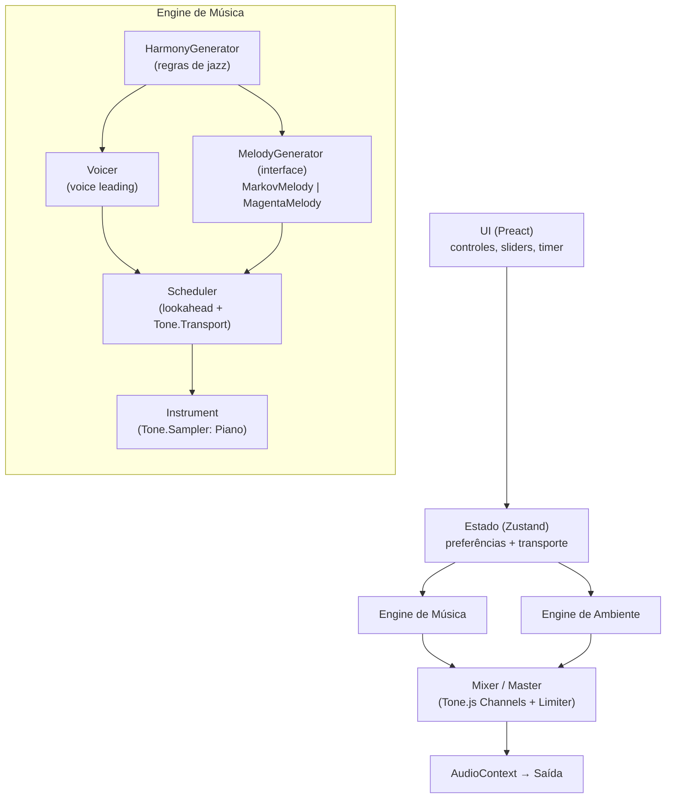
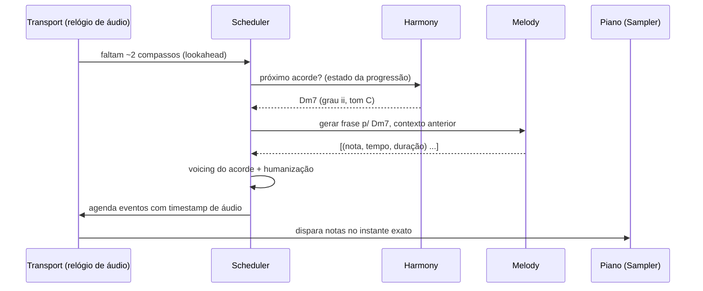

# Auto Rainjazz — Plano de Construção

> Documento para **crítica**. Nada aqui está implementado ainda. Cada decisão marcada com 🔶 é uma proposta que quero que você questione.

---

## 1. Visão

App web instalável (PWA) que **gera música de jazz suave em tempo real, no próprio dispositivo**, sobre uma camada de **ruído ambiente** (brisa, chuva leve, chuva) para concentração e relaxamento. Sem servidor de áudio, sem streaming, sem repetição perceptível.

### Objetivos
- Começar a tocar em **menos de 3 s** após o primeiro clique (com cache quente).
- **Consumo de CPU baixo** o bastante para rodar em notebook antigo e celular médio sem esquentar.
- Geração **infinita** e **plugável**: trocar o "cérebro" melódico (Markov → rede neural) sem tocar no resto.
- Funcionar **offline** depois da primeira visita.

### Não-objetivos (por enquanto)
- Não é um DAW nem editor de música.
- Não imita nenhum vídeo/canal específico; todo o material é sintetizado ou de licença livre.
- Sem contas, sem backend, sem telemetria.
- Violino/cello fica para a fase 3 (samples de cordas soam artificiais com notas curtas).

---

## 2. Requisitos

### Funcionais (MVP)
| # | Requisito |
|---|---|
| F1 | Seletor de ambiente: **Nenhum / Brisa / Chuva leve / Chuva** |
| F2 | Seletor de música: **Nenhuma / Piano** (Violino na fase 3) |
| F3 | Dois sliders de volume independentes (ambiente × música) |
| F4 | Play / Pause |
| F5 | Timer de sono (15 / 30 / 60 min) com fade-out |
| F6 | Geração contínua, sem fim |
| F7 | Botão "nova semente" (recomeça com outro tom e progressão) |

### Não funcionais (orçamento de performance) 🔶
| Métrica | Meta |
|---|---|
| Download inicial (sem samples) | < 150 KB gzip |
| Samples de piano | ≤ 3 MB |
| CPU média tocando (notebook médio) | < 8 % de um núcleo |
| Memória | < 150 MB |
| Latência play → som | < 300 ms depois de carregado |
| Funciona com tela bloqueada no celular | Melhor esforço (Media Session); garantia só via Capacitor |

---

## 3. Arquitetura

### 3.1 Visão em camadas



### 3.2 Fluxo de geração (por compasso)



**Princípio central:** o *relógio do áudio* (`AudioContext.currentTime`) manda. A lógica de geração roda **adiantada** (lookahead de 1–2 compassos) e só agenda eventos; nunca toca "na hora". Isso evita falhas de timing mesmo que a aba fique ocupada.

### 3.3 Interface plugável do gerador de melodia

```ts
interface MelodyGenerator {
  /** Gera as notas de um compasso sobre um acorde. */
  nextBar(ctx: BarContext): NoteEvent[];
  reset(seed: number): void;
}
```

`MarkovMelody` (v1) e `MagentaMelody` (v2) implementam a mesma interface. Trocar um pelo outro é uma linha de configuração, o que permite o **A/B** que você pediu.

---

## 4. Desenho tecnológico

| Camada | Tecnologia | Por quê | Alternativa descartada |
|---|---|---|---|
| Build | **Vite** | Dev server rápido, build enxuto | Webpack (mais pesado) |
| Linguagem | **TypeScript** 🔶 | Tipos protegem a lógica musical (graus, intervalos, MIDI) | JS puro |
| UI | **Preact** (3 KB) | Mesma API do React, quase sem peso | React (~40 KB), Svelte (também ok) |
| Estado | **Zustand** | Minúsculo, sem boilerplate | Redux |
| Áudio | **Tone.js** | Transport, Sampler, scheduling prontos sobre Web Audio | Web Audio cru (muito código), Howler (sem síntese) |
| Ruído | **Web Audio nativo** (AudioBufferSource + Biquad + LFO) | Barato e preciso | Loops gravados (repetem) |
| Piano | **Salamander Grand Piano** (reduzido) | Livre, excelente qualidade | Soundfonts GM (som datado) |
| PWA | **vite-plugin-pwa** (Workbox) | Cache dos samples + offline | Service worker manual |
| Testes | **Vitest** | Integrado ao Vite | Jest |
| Lint/format | **Biome** 🔶 | Uma ferramenta só, rápida | ESLint+Prettier |
| v2 (opcional) | **Magenta.js** + TF.js (wasm/cpu) em **Web Worker** | Modelo pronto para melodia sobre acordes | Treinar rede própria (mais trabalho) |
| App nativo (futuro) | **Capacitor** | Resolve áudio em segundo plano | React Native |

---

## 5. Estrutura de pastas

```
auto-rainjazz/
├── README.md
├── PLANO_CONSTRUCAO.md
├── LICENSE
├── package.json
├── tsconfig.json
├── vite.config.ts
├── biome.json
├── index.html
│
├── public/
│   ├── manifest.webmanifest
│   ├── icons/
│   └── samples/
│       └── piano/                 # Salamander reduzido (mp3/ogg) + ATTRIBUTION.txt
│
├── src/
│   ├── main.tsx                   # bootstrap
│   ├── app/
│   │   ├── App.tsx
│   │   ├── components/            # Player, AmbientPicker, VolumeSlider, SleepTimer
│   │   └── store.ts               # Zustand
│   │
│   ├── audio/
│   │   ├── context.ts             # inicialização do AudioContext (gesto do usuário)
│   │   ├── mixer.ts               # canais ambiente/música, master, limiter
│   │   ├── ambient/
│   │   │   ├── noise.ts           # geração de buffers branco/rosa/marrom
│   │   │   ├── wind.ts            # brisa
│   │   │   ├── rain.ts            # chuva leve/forte + gotas
│   │   │   └── ambientEngine.ts
│   │   └── music/
│   │       ├── theory/
│   │       │   ├── notes.ts       # MIDI ↔ nome, transposição
│   │       │   ├── scales.ts      # modos, pentatônicas, blues
│   │       │   └── chords.ts      # qualidades (maj7, m7, 7, m7b5...)
│   │       ├── harmony/
│   │       │   ├── progressions.ts# templates ii-V-I, turnarounds, menores
│   │       │   └── harmonyGenerator.ts
│   │       ├── melody/
│   │       │   ├── types.ts       # MelodyGenerator, NoteEvent, BarContext
│   │       │   ├── markovMelody.ts
│   │       │   ├── model.json     # tabela de transições treinada
│   │       │   └── magentaMelody.ts   # (v2) isolado, carregamento dinâmico
│   │       ├── voicing.ts         # voice leading
│   │       ├── humanize.ts        # microtiming, velocity
│   │       ├── scheduler.ts       # lookahead + Transport
│   │       ├── instruments/
│   │       │   └── piano.ts       # Tone.Sampler
│   │       └── musicEngine.ts
│   │
│   ├── workers/
│   │   └── melody.worker.ts       # (v2) inferência fora da thread principal
│   │
│   └── lib/
│       ├── prng.ts                # gerador pseudoaleatório com seed (mulberry32)
│       └── media-session.ts       # controles na tela de bloqueio
│
├── tools/
│   ├── build-markov-model.ts      # MIDI de jazz → model.json
│   ├── trim-samples.sh            # corta/reamostra Salamander
│   └── data/                      # MIDIs de treino (apenas licença livre)
│
├── tests/
│   ├── harmony.test.ts
│   ├── voicing.test.ts
│   ├── markov.test.ts
│   └── scheduler.test.ts
│
└── docs/
    ├── architecture.md
    └── assets/                    # banner do README
```

---

## 6. Cada técnica explicada

### 6.1 Harmonia por regras

**O que é.** Em vez de um modelo "aprender" quais acordes vêm depois de quais, codificamos o que a teoria do jazz já sabe. O jazz tem poucas fórmulas muito repetidas, o que o torna ideal para regras.

**Como funciona.**

1. **Escolha do tom** (semente aleatória): ex. Lá♭ maior.
2. **Escolha de um template de progressão**, escrito em graus (independente do tom):
   - `ii–V–I`: Dm7 → G7 → Cmaj7 (em C)
   - `I–vi–ii–V` (turnaround): Cmaj7 → Am7 → Dm7 → G7
   - `iii–VI–ii–V`: Em7 → A7 → Dm7 → G7
   - Menor: `iiø–V–i`: Dm7♭5 → G7♭9 → Cm7
3. **Qualidade dos acordes** vem de uma tabela (`maj7`, `m7`, `7`, `m7♭5`) com extensões opcionais (9ª, 13ª) escolhidas por probabilidade, para variar a cor.
4. **Duração**: um acorde por compasso, ocasionalmente dois por compasso (ritmo harmônico).
5. **Modulação suave**: a cada N ciclos, sobe uma quarta/quinta ou muda para o relativo, para a música não ficar presa num tom.

**Voicing e voice leading** (`voicing.ts`).
Tocar o acorde em posição fundamental soa duro. Usamos *voicings* de jazz:
- **Shell**: 3ª + 7ª (a "alma" do acorde) + 9ª ou 13ª na mão direita; fundamental na esquerda.
- **Voice leading**: para cada acorde seguinte, escolhemos a inversão que **minimiza o movimento total das notas** em relação ao anterior. É isso que dá a sensação de fluidez.

**Por que regras e não IA aqui.** Resultado garantido, zero custo de CPU, controlável (dá para ajustar "mais suave", "mais colorido") e fácil de testar.

### 6.2 Melodia por cadeia de Markov

**O que é.** Um modelo probabilístico em que a próxima nota depende só das últimas *N* notas (aqui N = 2, "ordem 2"). Sem rede neural: é uma **tabela de probabilidades**.

**Como funciona.**

- **Estado**: `(grau relativo ao acorde atual, duração)`. Usar o grau *relativo ao acorde* (e não a nota absoluta) faz o modelo funcionar em qualquer tom e sobre qualquer acorde.
- **Tabela**: para cada par de estados anteriores `(s₁, s₂)`, a lista de próximos estados com suas probabilidades. Fica em `model.json` (poucos KB).
- **Treino offline** (`tools/build-markov-model.ts`): lê MIDIs de jazz de licença livre, extrai melodias, converte para o grau relativo ao acorde e conta as transições. Roda uma vez, no desenvolvimento, nunca no usuário.
- **Geração em tempo real**: sorteia o próximo estado pela distribuição (com `temperature` para controlar o quão previsível é).

**Regras de segurança por cima** (o que torna "musical" e não só estatístico):
- Tempos fortes caem em **notas do acorde** (1, 3, 5, 7); tempos fracos aceitam notas de passagem da escala.
- Limite de **registro** (ex.: dó4–dó6) e de **salto** máximo entre notas (evita saltos esquisitos).
- **Pausas frequentes** (~30–40 %): é o que dá o clima relaxado. Silêncio é parte da música.
- Final de frase tende ao **grau resolutivo** (3ª ou 5ª do acorde).
- Fallback: se um estado não existir na tabela, cai para ordem 1 e depois para uma pentatônica.

**Custo.** Microssegundos por nota; 0 dependências além do JSON.

### 6.3 Piano Salamander

**O que é.** O *Salamander Grand Piano V3*, de Alexander Holm: gravação em alta qualidade de um Yamaha C5, distribuída como samples, **licença CC-BY 3.0** (uso livre, inclusive comercial, **com atribuição obrigatória**).

**Como é usado.**
- O original tem 16 camadas de dinâmica e uma amostra por nota (~1 GB). Inviável para a web.
- Vamos **reduzir**: 1 ou 2 camadas de dinâmica, **uma amostra a cada 3 semitons** (≈ 30 amostras), corte de silêncio, codificação **mp3/ogg** → **≤ 3 MB**.
- `Tone.Sampler` faz o resto: para notas intermediárias, ele **reamostra** (muda o pitch) a amostra mais próxima. Em 3 semitons a distorção de timbre é imperceptível em música suave.
- `tools/trim-samples.sh` automatiza o corte e a reamostragem.
- Os arquivos entram no cache do service worker, então só baixam uma vez.

**Atribuição.** `public/samples/piano/ATTRIBUTION.txt` + créditos na tela "Sobre" e no README.

### 6.4 Ruído ambiente

Tudo sintetizado, sem arquivos de áudio.

| Cor de ruído | Como obter | Uso |
|---|---|---|
| Branco | `Math.random()` em buffer | base de chuva |
| Rosa (−3 dB/oitava) | filtro de Paul Kellet sobre o branco | chuva suave |
| Marrom (−6 dB/oitava) | integração do branco | vento grave |

**Técnica de baixo custo:** gerar **um buffer de ~10 s uma vez** e tocá-lo em `loop` num `AudioBufferSourceNode`. Depois aplicar filtros e modulação (barato, feito pelo motor nativo do navegador). Para esconder a emenda do loop, usa-se *crossfade* ou dois sources com offsets diferentes.

- **Brisa**: ruído marrom/rosa → passa-baixa; o **LFO** (0,05–0,2 Hz) varia a frequência de corte e o volume, simulando rajadas.
- **Chuva leve**: ruído rosa → passa-banda ~2–6 kHz + **gotas** (pequenos estouros de ruído filtrado com envelope curto, disparados em intervalos aleatórios, ~5–15/s).
- **Chuva**: mesmo princípio, com mais densidade de gotas, mais volume e mais agudos; camada grave opcional (trovão distante muito suave, fase 2).
- **Nenhum**: o canal é silenciado e os nós, desconectados (CPU zero).

### 6.5 Scheduler com lookahead

JavaScript tem timers imprecisos; o relógio de áudio é preciso. Por isso:
- O gerador roda a cada ~100 ms e **olha 1–2 compassos à frente**.
- Cada nota é agendada com **timestamp absoluto** do `AudioContext`.
- Se a aba travar por 200 ms, o som continua correto, porque já estava agendado.

### 6.6 Humanização

Evita o "som de MIDI": pequenas variações aleatórias (com seed) de **tempo** (±15 ms), **velocity** (±10 %) e **duração**, mais um swing leve (~55 %).

### 6.7 Mixer, reverb e limiter

- Dois canais (`ambient`, `music`) → master → **limiter** para nunca estourar.
- **Reverb** dá o clima de sala. É a parte mais cara de CPU. 🔶 Plano: começar com `Tone.JCReverb` (algorítmico, leve); testar `Tone.Reverb` (convolução) só se o som ficar pobre.
- Fade-out do timer de sono pela automação do ganho master.

### 6.8 PWA e Media Session

- Service worker (Workbox) faz *precache* do app e dos samples.
- **Media Session API**: título, play/pause na tela de bloqueio e no fone.
- Limitação conhecida: iOS/Android podem suspender o áudio de abas em segundo plano. Mitigação parcial: `<audio>` silencioso em loop mantendo a sessão viva. Solução definitiva: Capacitor (fase 4).

### 6.9 Fase v2: Magenta ImprovRNN (A/B)

- `MagentaMelody` implementa `MelodyGenerator`, recebe a progressão de acordes e devolve a melodia.
- Carregado por **import dinâmico** (só baixa se o usuário escolher "melodia IA"), para não pesar o app base.
- Inferência em **Web Worker** com backend `wasm`/`cpu`, para não competir com o áudio.
- Checkpoint ~5–10 MB.
- Critérios de comparação (A/B): **CPU média**, **tamanho extra**, **diversidade percebida** e **escuta cega** (você + 2–3 pessoas).

---

## 7. Estratégia de performance

1. **Um único `AudioContext`**, criado no primeiro gesto do usuário.
2. **Desconectar** nós inativos (ambiente "Nenhum", música "Nenhuma").
3. **Lookahead curto**; nenhuma alocação grande no laço de geração.
4. Geração musical é trivial; **o orçamento vai para reverb e polifonia** → limitar a **~16 vozes** simultâneas no Sampler.
5. `Page Visibility`: se a aba for escondida e a Media Session não estiver ativa, reduzir atividade visual (a UI não anima nada pesado).
6. Medição real: `performance.now()` no gerador + Chrome Performance + `AudioContext.baseLatency`; painel de debug opcional (`?debug`).
7. Nada de TF.js no bundle base.

---

## 8. Estratégia de testes

- **Determinismo por seed**: mesma semente ⇒ mesma música. Isso torna os testes de harmonia, voicing e Markov reproduzíveis.
- **Propriedades** (Vitest): todo acorde gerado pertence ao tom; saltos de voicing ≤ limite; notas da melodia dentro do registro; tempos fortes em notas do acorde.
- Scheduler testado com relógio falso.
- Teste manual de escuta (checklist em `docs/`): 30 min contínuos sem repetição óbvia, sem estalos, sem acúmulo de memória.

---

## 9. Roadmap

| Fase | Entrega | Critério de pronto |
|---|---|---|
| **0 — Fundação** | Vite + TS + Preact, CI básico, Biome, Vitest | `npm run dev` abre página vazia; testes rodam |
| **1 — Ambiente** | Brisa/chuva leve/chuva, mixer, volume | Ouvir 10 min sem estalo na emenda; CPU < 3 % |
| **2 — Música v1** | Teoria + harmonia + Markov + piano Salamander reduzido + scheduler | Gera 30 min sem erro; soa como jazz suave |
| **3 — Produto** | Timer de sono, PWA offline, Media Session, UI polida | Instala no celular e funciona offline |
| **4 — v2 IA (A/B)** | `MagentaMelody` em Worker + comparação | Relatório de CPU/tamanho/escuta |
| **5 — Extras** | Violino/cello, trovão, presets, Capacitor | decidir pelo feedback |

---

## 10. Riscos e licenças

| Risco | Impacto | Mitigação |
|---|---|---|
| Melodia Markov soar aleatória/"sem alma" | Alto | Regras de tempo forte + pausas + dados de treino cuidadosos; fallback para v2 |
| Reverb pesar na CPU | Médio | JCReverb primeiro; medir |
| Samples grandes demais | Médio | Corte agressivo, 1 camada de dinâmica |
| Áudio suspenso em segundo plano | Médio | Media Session + `<audio>` mudo; Capacitor depois |
| Dados de treino com licença incompatível | Alto | Usar só MIDI em domínio público/CC0, ou **compor frases próprias** no estilo |
| Atribuição do Salamander esquecida | Legal | `ATTRIBUTION.txt` + tela Sobre + README |
| Autoplay bloqueado pelo navegador | Baixo | Só iniciar o áudio após clique em Play |

**Licenças:** código do projeto sob MIT 🔶; Salamander CC-BY 3.0 (atribuição); Tone.js MIT; Magenta Apache-2.0.

---

## 11. Decisões em aberto (para sua crítica)

1. 🔶 **TypeScript** (assumido, você não respondeu) ou JS puro?
2. 🔶 **Preact** + Zustand, ou prefere React/Svelte/vanilla?
3. 🔶 **Origem dos dados de treino do Markov**: MIDIs livres da internet ou eu escrevo à mão um conjunto pequeno de frases-modelo (mais controle, menos variedade)?
4. 🔶 **Reverb**: aceita começar com o algorítmico (mais leve, menos "sala real")?
5. 🔶 **Escopo do MVP**: incluir o timer de sono já na fase 3, ou deixar para depois?
6. 🔶 **Licença do projeto** (MIT, GPL, privado)?
7. ✅ **Nome**: `auto-rainjazz` (decidido; livre no npm e no GitHub em 09/11/2026).
8. 🔶 **Faixa de andamento**: 55–75 BPM (bem lento) está de acordo com o que você escuta no canal de referência?
