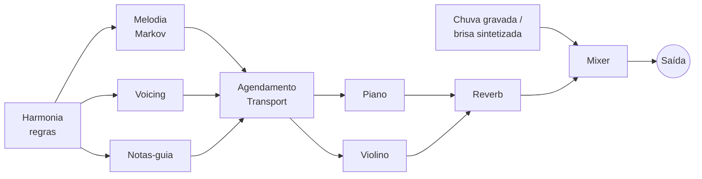

<div align="center">


# 🌧️🎹 Auto Rainjazz

**Jazz suave gerado na hora, no seu dispositivo, com chuva ao fundo.**
Para concentrar, estudar e relaxar. Sem streaming, sem conta, sem repetição.


</div>

---

## ✨ O que é

Um app web que **compõe música em tempo real** enquanto você ouve, em cima de uma camada de chuva ou brisa à sua escolha. Tudo roda **localmente no navegador**: a música é gerada no aparelho e os sons dos instrumentos vêm junto com o app.

## 🎛️ Recursos

- 🌬️ **Ambiente:** nenhum · brisa · chuva leve · chuva
- 🎹 **Música:** nenhuma · piano · piano + violino
- 🔊 Volumes independentes de ambiente e música
- ⏱️ Timer de sono com fade-out
- 💾 Lembra suas escolhas (ambiente, música, volumes, timer) entre visitas
- ⏯️ Controles de mídia do sistema (tela de bloqueio, teclas de mídia), onde o navegador oferece
- ♾️ Geração contínua, sem fim

## 🧠 Como funciona

| Peça | Técnica |
|---|---|
| **Harmonia** | Regras de jazz (ii–V–I, turnarounds) com voice leading |
| **Melodia** | Cadeia de Markov de ordem 2, restrita às notas do acorde nos tempos fortes e com muitas pausas |
| **Violino** | A cada ciclo de 4 compassos, ou conduz a melodia em legato, ou sustenta notas-guia (3ª/7ª) sob a melodia do piano, ou descansa |
| **Instrumentos** | Piano Salamander Grand (1,3 MB) e violino (720 KB) tocados por `Tone.Sampler`, com reverb compartilhado |
| **Chuva** | Gravações reais (chuva em folhas e chuva forte), ~1 min cada, transformadas em loop sem emenda no navegador |
| **Brisa** | Ruído marrom com LFO no corte do filtro |
| **Timing** | Transport do Tone.js (lookahead sobre o relógio de áudio) |
| **v2 (opcional)** | Melodia por rede neural (Magenta ImprovRNN) em Web Worker, comparada em A/B com o Markov |



Detalhes completos e decisões em **[PLANO_CONSTRUCAO.md](./PLANO_CONSTRUCAO.md)** e **[contexto.md](./contexto.md)**.

## 🧰 Stack

Vite · TypeScript · Preact · Zustand · Tone.js · Web Audio API · Vitest

## 🚀 Começando

```bash
cd auto-rainjazz
npm install
npm run dev      # abre em http://localhost:5173
```

Scripts:

```bash
npm run dev          # servidor de desenvolvimento
npm run build        # build de produção
npm run test         # testes (Vitest)
npm run typecheck    # tsc --noEmit
```

> Use Node 22 (`export PATH=/opt/homebrew/opt/node@22/bin:$PATH` se o `node` padrão do Homebrew estiver quebrado).

## 🗺️ Roadmap

- [x] **Fase 0:** fundação (Vite, TS, testes, CI)
- [x] **Fase 1:** ambiente (brisa, chuva leve, chuva); chuva agora com gravações reais
- [x] **Fase 2:** música v1 (harmonia + Markov + piano)
- [~] **Fase 3:** timer de sono, preferências salvas, Media Session e samples locais feitos; falta PWA offline (service worker + manifest)
- [ ] **Fase 4:** melodia por IA (Magenta) e comparação A/B
- [~] **Fase 5:** violino feito; faltam cello, trovão, presets e app nativo (Capacitor)

## 📁 Estrutura

```
src/
├── app/          # UI (Preact) e estado (Zustand)
├── audio/
│   ├── ambient/  # chuva (gravações em loop) e brisa (sintetizada)
│   └── music/    # teoria, harmonia, melodia, voicing, violino, instrumentos, motor
└── lib/          # PRNG com seed
public/samples/   # piano e violino (mp3)
public/ambient/   # gravações de chuva (mp3)
tests/
```

## 📜 Licenças e créditos

- Código: **MIT**
- Piano: [Salamander Grand Piano V3](https://sfzinstruments.github.io/pianos/salamander/) por Alexander Holm, **CC-BY 3.0** (via [Tone.js audio](https://github.com/Tonejs/audio))
- Violino: samples de [tonejs-instruments](https://github.com/nbrosowsky/tonejs-instruments) por Nicholaus Brosowsky, **CC-BY 3.0** (cortados para 6 s e convertidos para mono)
- Chuva leve (`public/ambient/chuva-leve.mp3`): "[rain on leaves](https://commons.wikimedia.org/wiki/File:Rain_on_leaves_(Gravity_Sound).wav)" por Gravity Sound, **CC BY 4.0** (trecho de 59 s, passa-altas 110 Hz, volume normalizado com limitador)
- Chuva forte (`public/ambient/chuva-forte.mp3`): "[October rain in Nepal](https://commons.wikimedia.org/wiki/File:October_rain_in_Nepal.ogg)" por Nirmal Dulal, **CC BY-SA 4.0** (trecho de 59 s sem um pico em 26 s, passa-altas 70 Hz, volume normalizado); o arquivo editado segue sob **CC BY-SA 4.0**
- [Tone.js](https://tonejs.github.io/) (MIT) · [Magenta.js](https://github.com/magenta/magenta-js) (Apache-2.0)

## 🤝 Contribuindo

Projeto em fase de testes de escuta. Críticas são bem-vindas: abra uma issue ou comente o `PLANO_CONSTRUCAO.md`.
