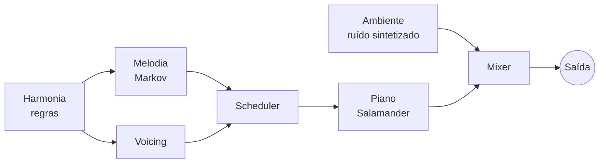

<div align="center">


# 🌧️🎹 Auto Rainjazz

**Jazz suave gerado na hora, no seu dispositivo, com chuva ao fundo.**
Para concentrar, estudar e relaxar. Sem streaming, sem conta, sem repetição.


</div>

---

## ✨ O que é

Um app web instalável (PWA) que **compõe música em tempo real** enquanto você ouve, em cima de uma camada de ruído ambiente à sua escolha. Tudo roda **localmente no navegador**, usa pouca CPU e funciona offline depois da primeira visita.

## 🎛️ Recursos (MVP)

- 🌬️ **Ambiente:** nenhum · brisa · chuva leve · chuva
- 🎹 **Música:** nenhuma · piano jazz suave (violino/cello em breve)
- 🔊 Volumes independentes de ambiente e música
- ⏱️ Timer de sono com fade-out
- ♾️ Geração contínua, sem fim
- 📲 Instalável e offline

## 🧠 Como funciona

| Peça | Técnica |
|---|---|
| **Harmonia** | Regras de jazz (ii–V–I, turnarounds) com voice leading |
| **Melodia** | Cadeia de Markov de ordem 2, restrita às notas do acorde nos tempos fortes e com muitas pausas |
| **Som do piano** | Salamander Grand Piano reduzido (≤ 3 MB) tocado por `Tone.Sampler` |
| **Ambiente** | Ruído branco/rosa/marrom sintetizado + filtros + LFO + gotas aleatórias |
| **Timing** | Scheduler com lookahead sobre o relógio de áudio |
| **v2 (opcional)** | Melodia por rede neural (Magenta ImprovRNN) em Web Worker, comparada em A/B com o Markov |



Detalhes completos, estrutura de pastas e decisões em **[PLANO_CONSTRUCAO.md](./PLANO_CONSTRUCAO.md)**.

## 🧰 Stack

Vite · TypeScript · Preact · Zustand · Tone.js · Web Audio API · Workbox (PWA) · Vitest · Biome

## 🚀 Começando

```bash
cd auto-rainjazz
npm install
npm run dev      # abre em http://localhost:5173
```

Scripts:

```bash
npm run dev       # servidor de desenvolvimento
npm run build     # build de produção + PWA
npm run test      # testes (Vitest)
npm run typecheck # tsc --noEmit
```

## 🗺️ Roadmap

- [x] **Fase 0:** fundação (Vite, TS, testes)
- [x] **Fase 1:** ambiente (brisa, chuva leve, chuva) — implementado, falta ouvir/ajustar
- [x] **Fase 2:** música v1 (harmonia + Markov + piano) — implementado, falta ouvir/ajustar
- [~] **Fase 3:** timer de sono feito; faltam PWA offline e Media Session
- [ ] **Fase 4:** melodia por IA (Magenta) e comparação A/B
- [ ] **Fase 5:** violino/cello, trovão, presets, app nativo (Capacitor)

## 📁 Estrutura

```
src/
├── app/        # UI e estado
├── audio/
│   ├── ambient/  # brisa, chuva
│   └── music/    # teoria, harmonia, melodia, voicing, scheduler, piano
├── workers/    # inferência da IA (v2)
└── lib/        # PRNG com seed, Media Session
tools/          # treino do Markov, corte dos samples
tests/
```

## 📜 Licenças e créditos

- Código: **MIT**
- Piano: [Salamander Grand Piano V3](https://sfzinstruments.github.io/pianos/salamander/) por Alexander Holm, **CC-BY 3.0**
- [Tone.js](https://tonejs.github.io/) (MIT) · [Magenta.js](https://github.com/magenta/magenta-js) (Apache-2.0)

## 🤝 Contribuindo

Projeto em fase de planejamento. Críticas ao plano são bem-vindas: abra uma issue ou comente o `PLANO_CONSTRUCAO.md`.
